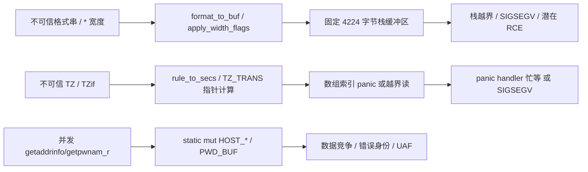

# keel 安全审计报告

> 审计日期：2026-11-15
> 审计对象：`keel` 本地仓库，commit `132ffa310b6808b1ee5b7b5c7cc24e3772dd284a`
> 审计类型：白盒源码审计（C ABI 内存安全、不可信输入解析、线程安全、危险格式化）
> 授权：项目所有者请求，仅限本地仓库

## 0. 执行摘要

本轮审计覆盖了 keel 的 C ABI 边界、DNS/名字服务、printf 家族、TZif/TZ、passwd/group/shadow、iconv 和独立 ELF loader。共确认 **8 个问题**，其中：

- **4 个高危**：printf 宽度/精度导致的栈越界/CPU 自旋；panic handler 将任意 panic 变成永久忙等；`*_r` 口令/组查询不是可重入实现；`getaddrinfo`/`getnameinfo`/resolver 使用无锁静态状态。
- **1 个中危**：TZif/TZ 解析缺少校验。
- **3 个低危/加固项**：iconv WCHAR_T 非对齐访问、ELF loader 校验不足、`getgrouplist` 负 `ngroups`。

**结论：当前版本不建议直接暴露给处理不可信格式串、TZ/zoneinfo、并发名字服务或多线程口令查询的进程。** 建议先修复 P0（printf、panic handler），再修复 P1（TZ、`_r`、resolver 并发）。

## 1. 范围与方法

| 项目 | 详情 |
|------|------|
| 代码范围 | `libc/src/`、`src/`（独立 loader），重点为 C ABI 入口和不可信输入解析 |
| 测试基线 | commit `132ffa3`；`cargo test --workspace` 55 个 target 通过；`libc-test` regression 67 PASS / 1 SKIP / 0 FAIL；functional 73 PASS / 0 FAIL |
| 对照实现 | 本地 musl 1.2.6（sibling checkout） |
| 工具 | 人工代码审查、`rg` 模式扫描、`cargo clippy`、`cargo tree`、OSV API、C harness 差分复现 |
| 未使用 | semgrep、cargo-audit、cargo-geiger（环境未安装）；未做网络目标渗透 |
| 不在范围 | 密码算法正确性、内核 syscall 语义、APK 打包/签名、真实网络服务渗透 |

### 1.1 信任边界

- C ABI：所有 `#[no_mangle] extern "C"` 函数的指针/长度参数。
- 网络：DNS 响应、PTR/A/AAAA 记录、压缩指针。
- 文件：`/etc/hosts`、`/etc/resolv.conf`、`/etc/passwd`、`/etc/group`、`/etc/shadow`、`/etc/services`、zoneinfo/TZif。
- 环境：`TZ`、`LD_*`、locale、`RES_OPTIONS` 等。
- 格式化：printf 家族的格式串、`*` 宽度/精度参数。
- 二进制：独立 `keel` loader 读取的 ELF header/PT_LOAD/动态段。

### 1.2 方法

1. 对最近提交（安全层、DNS、wordexp）做逐行复核和差分测试。
2. 对高风险子系统做危险模式扫描：`copy_nonoverlapping`、`from_raw_parts`、`static mut`、裸指针 `add`、固定栈缓冲区、`strlen` 后复制。
3. 为每个候选问题构造最小 C harness，在 keel 和真实 musl 下对比行为。
4. 对无法用单次 harness 复现的并发问题，按 POSIX 线程安全要求和 `static mut` 数据流确认。

### 1.3 不适用的检查项

- 鉴权、多租户隔离、SSRF、文件上传：keel 是 libc，本身没有服务端鉴权/HTTP 层，不适用。
- 危险 exec：`wordexp`/`popen` 的 shell 执行是 POSIX 语义；`WRDE_NOCMD` 路径已在 `wordexp_test` 中验证。
- 密钥/token 存储：libc 不保存应用密钥；`/etc/shadow` 仅由 `getspnam*` 读取，访问控制依赖文件权限。

## 2. 证据链

### 2.1 Scope 摘要

- 授权范围：本地仓库，无外部网络目标。
- 高价值资产：C ABI 内存安全、名字服务结果、口令/组查询、进程可用性。
- 攻击者模型：能影响 DNS 响应、TZ/zoneinfo、格式串或 `*` 参数、并发请求的本地/远程输入源；不假设攻击者已能执行任意代码。

### 2.2 Evidence

| E-id | source_ref | repro_command | content_hash |
|------|------------|---------------|--------------|
| E-1 | `libc/src/lib.rs:7689`、`7547` | `snprintf(out, n, "%*d", -5, 1)` → keel SIGSEGV；musl `[1    ]` | n/a |
| E-2 | `libc/src/lib.rs:7851`、`7547` | `snprintf(out, 200000, "%10000d", 1)` → keel SIGSEGV；musl 输出 10000 字节 | n/a |
| E-3 | `libc/src/lib.rs:7069`、`7698` | `snprintf(out, 200000, "%.2000f", 1.0)` → keel 超时（CPU 自旋）；musl 输出 2002 字节 | n/a |
| E-4 | `libc/src/tz.rs:190`、`lib.rs:10857` | `TZ='EST5EDT,M99.1.1/0,M10.1.1/0' localtime()` → keel 超时；musl 正常 | n/a |
| E-5 | `libc/src/tz.rs:397-418` | 44 字节伪造 TZif（timecnt/typecnt=0xffffffff）+ `TZ=<file>` → keel SIGSEGV；musl 同样 SIGSEGV | n/a |
| E-6 | `libc/src/lib.rs:19116-19219` | `getpwnam_r("root", &pw, buf, sizeof buf, &res)` → `res->pw_name` 不在 `buf` 内（keel `in_buf=0`，musl `in_buf=1`） | n/a |
| E-7 | `libc/src/lib.rs:19728`、`22588-22598`、`netdb_extra.rs:615` | `h_errno`、`HOST_ENT`、`HOST_NAME`、`HOSTS_BUF` 为无锁 `static mut` | n/a |
| E-8 | `libc/src/lib.rs:5042`、`5233` | `*(src as *const u32)` / `*(dst as *mut u32)` 非对齐裸访问 | n/a |
| E-9 | `src/loader_core.rs:115-123`、`264` | `e_phentsize` 未校验；`rela_ent == 0` 可除零 | n/a |
| E-10 | `libc/src/lib.rs:23181` | `*ngroups` 为负时 `as usize` 变成极大值 | n/a |
| E-11 | 最近提交 | `cargo test --workspace` 55 target、`libc-test`、`dn_expand`/`ns_parse` 差分 | commit `132ffa3` |

### 2.3 Findings 汇总

| F-id | 严重性 | 标题 | 证据 | 状态 |
|------|--------|------|------|------|
| F-1 | 高（可升级为严重） | printf 宽度/精度导致栈越界或忙等 | E-1/E-2/E-3 | 已验证 |
| F-2 | 高 | panic handler `loop {}` 将 panic 变成永久 CPU 自旋 | E-3/E-4 | 已验证 |
| F-3 | 中 | TZif/TZ 解析缺少边界/字段校验 | E-4/E-5 | 已验证 |
| F-4 | 高 | `getpwnam_r`/`getgrnam_r`/`getspnam_r` 不是可重入实现 | E-6 | 已验证 |
| F-5 | 高 | `getaddrinfo`/`getnameinfo`/resolver 无锁静态状态 | E-7 | 代码确认 |
| F-6 | 低 | iconv WCHAR_T 非对齐读写 | E-8 | 代码确认 |
| F-7 | 低 | 独立 ELF loader 校验不足 | E-9 | 代码确认 |
| F-8 | 低 | `getgrouplist` 负 `ngroups` 越界写 | E-10 | 代码确认 |

### 2.4 Path



### 2.5 Timeline

| 时间 | 事件 |
|------|------|
| 2026-11-15 | 复核安全层与最近的 DNS/wordexp 修复 |
| 2026-11-15 | printf `%*d`/`%10000d`/`%.2000f` 复现 |
| 2026-11-15 | TZ `M99` 与伪造 TZif 复现 |
| 2026-11-15 | passwd/group `_r` 缓冲区归属验证 |
| 2026-11-15 | 静态检查依赖与 clippy |

## 3. 发现详情

### F-1 printf 宽度/精度导致栈越界或忙等

**严重性**：高（如果格式串或 `*` 参数来自不可信输入，可升级为严重/潜在代码执行）
**位置**：
- `libc/src/lib.rs:6445-6470`（流式 printf 的宽度/精度解析）
- `libc/src/lib.rs:7689-7710`（`format_to_buf` 的宽度/精度解析）
- `libc/src/lib.rs:7547`（`apply_width_flags`）
- `libc/src/lib.rs:6827`（`format_int`，整数宽度 padding）
- `libc/src/lib.rs:7069`（`format_f64_full` 内部 `fbuf[1100]`）
- `libc/src/lib.rs:7851-7872`、`7974-7976`（`fbuf[4224]` / `wbuf[4224]`）

**描述**：

1. `*` 宽度直接 `args.next_arg::<c_int>() as usize`。负宽度按 C 语义应表示 `-` 标志加绝对值，但这里变成巨大的 `usize`，`apply_width_flags` 的 `for i in 0..pad` 会向 `wbuf[4224]` 持续写入。
2. 格式串中的大宽度（如 `%10000d`）不做上限检查，同样写入 4224 字节的栈缓冲区。
3. `%.2000f` 的精度被直接用于 `format_f64_full` 内部的 `fbuf[1100]` 下标；`p >= 1100` 触发 Rust 数组越界 panic。

**证据**：

```text
$ keel: snprintf(..., "%*d", -5, 1)
Segmentation fault (exit 139)
$ musl: [1    ]

$ keel: snprintf(..., "%10000d", 1)
Segmentation fault (exit 139)
$ musl: n=10000

$ keel: snprintf(..., "%.2000f", 1.0)
timeout (exit 124, 无输出)
$ musl: n=2002
```

**影响**：

- 负 `*` 宽度是正常 C 用法；任何使用 `printf("%*s", width, str)` 且 width 来自用户数据的程序都会崩溃。
- 大宽度/精度可造成栈缓冲区越界写，理论上可控制返回地址；至少是稳定 DoS。
- 精度 >= 1100 触发 panic；结合 F-2，进程进入永久 CPU 自旋。

**修复建议**：

- `*` 宽度按有符号解析：负值设置 `FLAG_MINUS`，宽度取绝对值（注意 `i32::MIN`）。
- 不要在固定 4224 字节栈缓冲区中物化 padding；通过 sink 分块输出，或按 `cap` 截断并继续计数（`snprintf` 语义）。
- 为浮点精度设置明确上限（例如 1074/1100），或使用动态分配的 digit 缓冲区；不能继续用固定 `fbuf[1100]`。
- 为 `%d`/`%s`/`%f` 增加 `%*d`、`%10000d`、`%.2000f`、`%.*f` 的回归测试。

### F-2 panic handler 将任意 panic 变成永久 CPU 自旋

**严重性**：高（可用性）
**位置**：`libc/src/lib.rs:146-149`

```rust
#[panic_handler]
fn panic(_: &core::panic::PanicInfo) -> ! {
    loop {}
}
```

**描述**：Rust 的数组越界、`unwrap`、断言等 panic 在 libc 内不会终止进程，而是进入无休止的 `loop {}`。如果 panic 发生在持有 spinlock 的路径上（例如 `tz_lock`），其他线程也会被永久阻塞。

**证据**：

- `TZ='EST5EDT,M99.1.1/0,M10.1.1/0' localtime()` → `timeout`，100% CPU；根因是 `month_to_secs(98)` 数组越界 panic（E-4）。
- `snprintf("%.2000f")` → 同样忙等（E-3）。

**影响**：任何可触发的 panic 都变成永久 DoS；比 abort 更难检测，且可能持有锁。

**修复建议**：

- panic handler 调用 `abort()`（SIGABRT）或 `_exit(134)`，不要自旋。
- 对不可信输入路径，优先返回错误码/回退值，而不是依赖 panic。
- 在 CI 中把“panic 即失败”作为解析器测试的断言（可用 `panic = "abort"` + 子进程检查退出码）。

### F-3 TZif/TZ 解析缺少边界和字段校验

**严重性**：中（需要控制 TZ/TZif 文件；与 musl 共享部分行为）
**位置**：`libc/src/tz.rs:190-215`、`397-418`

**描述**：

- TZif 只校验 `map_size >= 44` 和 magic，随后直接用 header 中的 `timecnt/typecnt/charcnt` 计算 `TZ_TRANS/TZ_INDEX/TZ_TYPES/TZ_ABBREVS`，没有验证这些范围是否落在 `map_size` 内。
- TZif 的 `ttinfo` 缩写索引 `*p.add(5)` 没有和 `TZ_ABBREVS_END` 比较，`tzname` 可以指向映射区外。
- POSIX TZ 规则的月份 `M99`/`M0` 没有校验，`month_to_secs` 用 `m-1` 作数组下标；`M99` 触发 panic（再叠加 F-2 变成忙等）。

**证据**：

- 44 字节伪 TZif：`timecnt=0xffffffff, typecnt=0xffffffff` → keel SIGSEGV；musl 也 SIGSEGV（共享上游行为）。
- `TZ='EST5EDT,M99.1.1/0,M10.1.1/0'` → keel 超时；musl 正常返回 1969 年 EST。

**影响**：不可信 zoneinfo/`TZ` 可导致崩溃、CPU 自旋，或通过 `tzname` 泄露映射区外的字节；容器/多租户场景下 TZ/zoneinfo 可能受控。

**修复建议**：

- 在 `do_tzset` 中计算每个数据块的长度，做 `skip + header + timecnt*scale + timecnt + 6*typecnt + charcnt <= map_size` 校验；任何失败回退 UTC。
- 校验 `ttinfo` 的 `abbr index < charcnt`、`ttinfo` 数量与 `TZ_TYPES` 范围。
- `getrule` 校验月份 `1..=12`、`n 1..=5`、`d 1..=31`；非法规则回退 UTC/忽略 DST。
- 对 TZif/TZ 增加 fuzz/差分测试。

### F-4 `getpwnam_r`/`getgrnam_r`/`getspnam_r` 不是可重入实现

**严重性**：高（多线程口令/组查询，可能返回错误身份）
**位置**：
- `libc/src/lib.rs:19116` `getpwnam_r`
- `libc/src/lib.rs:19123` `getpwuid_r`
- `libc/src/lib.rs:19212` `getgrnam_r`
- `libc/src/lib.rs:19219` `getgrgid_r`
- `libc/src/lib.rs:23166` `getspnam_r`

**描述**：这些 `_r` 函数忽略调用者的 `buf`/`buflen`，直接调用非 `_r` 版本，然后把静态 `PWD_ENT`/`GRP_ENT`/`SPWD_ENT` 结构体按值复制到调用者结构体；字符串指针仍指向静态 `PWD_BUF`/`GRP_BUF`/`SPWD_BUF`/`GRP_MEM`。并发调用会：

- 共享并重写静态缓冲区，返回交错/错误的用户名、UID、组、shadow hash；
- 另一个线程调用 `getpwnam` 时 `ensure_pwd_buf` 可能 `realloc`，已返回的字符串指针变成悬空指针（UAF）；
- 调用 `getpwent`/`getgrent` 时的全局 `FILE*` 也会被并发复用。

**证据**：

```text
struct passwd pw; char buf[1024]; struct passwd *res;
getpwnam_r("root", &pw, buf, sizeof buf, &res);
keel: name=root in_buf=0
musl: name=root in_buf=1
```

（`in_buf` 表示 `res->pw_name` 是否落在调用者 `buf` 内。）

**影响**：`_r` API 的核心承诺是线程安全和调用者缓冲区所有权。破坏它会导致多线程认证/授权代码读到错误用户数据，属于身份混淆风险；realloc 竞态可导致 UAF。

**修复建议**：

- 为每个 `_r` 函数实现独立路径：本地 `FILE*` + `getline` 状态，解析到调用者 `buf`，遵守 `buflen` 并返回 `ERANGE`；或
- 最小修复：加全局锁，调用非 `_r` 版本后把字符串复制到调用者 `buf`，再填充结构体；这样至少保证线程安全和缓冲区别名正确。
- 不要从 `_r` 函数调用 `getpwnam`/`getgrnam`/`getspnam`。

### F-5 `getaddrinfo`/`getnameinfo`/resolver 无锁静态状态

**严重性**：高（POSIX 要求 `getaddrinfo`/`getnameinfo` 线程安全）
**位置**：
- `libc/src/lib.rs:19728`：`pub static mut h_errno: i32`
- `libc/src/lib.rs:22588-22598`：`HOST_ENT`、`HOST_NAME`、`HOST_ADDR`、`HOST_ADDR_PTRS`
- `libc/src/netdb_extra.rs:615`：`HOSTS_BUF`
- `libc/src/lib.rs:22284-22287`：`NS_COUNT`、`NS_ADDRS`、`SEARCH_COUNT`、`SEARCH_DOMAINS`
- `netdb_extra.rs` 的 `hosts_lookup_name`/`hosts_lookup_addr`，以及 `lib.rs` 的 `gethostbyname2`

**描述**：

- `getaddrinfo` 在 `/etc/hosts` 路径使用静态 `HOSTS_BUF`/`HOST_ENT`；DNS 路径调用 `gethostbyname2`，后者使用静态 `HOST_ENT`/`HOST_NAME`/`HOST_ADDR`。并发 `getaddrinfo` 调用会互相覆盖结果。
- `getnameinfo` 的 PTR 路径使用 `hosts_lookup_addr` 写静态 `HOST_NAME`；并发调用会返回其他线程的主机名。
- `res_query`/`res_send` 读取 `NS_ADDRS`/`SEARCH_DOMAINS`，首次调用时 `resolv_parse_config` 无锁写入这些 `static mut`；并发首次查询存在数据竞争（Rust 中即 UB）。
- `h_errno` 是全局变量；`__h_errno_location` 返回同一地址，DNS 错误码在并发线程间互相覆盖。
- `getservbyname`/`getservbyport` 的静态 `SERV_ENT`/`SERV_BUF` 也被 `getaddrinfo`/`getnameinfo` 调用。

**影响**：多线程服务可能解析到错误地址/主机名/服务，导致连接到错误目标、认证到错误身份或 SSRF 类风险；并发读写还可能导致 `strlen` 读到未终止缓冲区，升级为越界读。

**修复建议**：

- 为 resolver/名字服务加全局锁（最小修复），或改为线程局部/调用局部缓冲区。
- `h_errno` 改成线程局部（复用 TCB 或 `#[thread_local]` 机制）。
- `resolv_parse_config` 用一次性初始化锁（`pthread_once` 风格）保护。
- `getaddrinfo`/`getnameinfo` 不要调用非重入的 `gethostbyname*`/`getserv*`，改为把解析逻辑内联到局部缓冲。

### F-6 iconv WCHAR_T 非对齐读写

**严重性**：低（跨架构 UB/潜在 fault）
**位置**：`libc/src/lib.rs:5042`、`5233`

```rust
let c = *(src as *const u32);      // decode WCHAR_T
*(dst as *mut u32) = c;            // encode WCHAR_T
```

**描述**：`iconv` 的 `char*` 输入/输出缓冲区没有 4 字节对齐保证；对 `*const u32`/`*mut u32` 的直接解引用要求指针对齐，否则是 UB。x86_64 通常能容忍非对齐访问，aarch64/riscv64 在特定配置或 Miri 下会暴露。

**影响**：严格对齐架构上可能 fault；Miri/优化器可能利用对齐假设产生错误代码。

**修复建议**：使用 `core::ptr::read_unaligned(src as *const u32)` 和 `core::ptr::write_unaligned(dst as *mut u32, c)`；增加一个输入/输出偏移 1 字节的 `iconv` 回归测试。

### F-7 独立 ELF loader 校验不足

**严重性**：低（同权限 DoS/健壮性）
**位置**：`src/loader_core.rs:115-123`、`226-280`

**描述**：

- `parse_phdrs` 用 `e_phnum * e_phentsize` 校验文件范围，但没有要求 `e_phentsize == size_of::<Phdr>()`；如果 `e_phentsize < 56`，随后按 `Phdr` 数组读取会越过已验证区域。
- 直接把 `data.as_ptr().add(e_phoff)` 转成 `*const Phdr`，`e_phoff` 未对齐时是非对齐解引用。
- `apply_relocations_from_dynamic` 中 `count = rela_sz / rela_ent`；`DT_RELAENT = 0` 会除零。
- `rela_off + i * rela_ent` 未做 `checked_add`/`checked_mul`；`r_offset` 直接用于写 `base_addr + r_offset`，没有验证目标落在可写 PT_LOAD 内。

**影响**：恶意/malformed ELF 可使 loader 崩溃或写任意地址。由于 loader 与被加载程序同权限，不构成提权，但对作为服务/沙箱加载器的使用场景是健壮性问题。

**修复建议**：校验 `e_phentsize == 56`、`e_phoff` 对齐；所有 offset/size 用 `checked_*`；`rela_ent != 0`；`r_offset` 必须落在某个 PT_LOAD 的可写范围。

### F-8 `getgrouplist` 负 `ngroups` 越界写

**严重性**：低
**位置**：`libc/src/lib.rs:23181`

```rust
let max = *ngroups as usize;
let mut n = 0usize;
if n < max { *groups.add(n) = group; }
```

**描述**：调用者传入负的 `*ngroups`（无效参数）时，`as usize` 变成 `usize::MAX`，`n < max` 成立，向 `groups[0]` 写入；后续组也可能继续写入。C API 通常应拒绝负值。

**修复建议**：入口检查 `*ngroups < 0` 返回 `-1`；所有 `n + 1`/`cap * 2` 使用 checked 算术。

## 4. 已修复/已验证的正面结果

最近提交中的以下修复经过复核和差分验证：

- `dn_expand` 的 `space <= 0`、`p == end`、`>=` 边界检查和 `checked_sub`：`dn_expand` 20,000 例与 musl 一致。
- `dn_skipname` 的截断处理：20,000 例与 musl 一致。
- `ns_initparse`/`ns_parserr`/`ns_skiprr` 迁移到 `InBuf`：5,000 个合法/畸形报文与 musl 的返回值、errno、记录字段一致。
- `wordexp` 的 terminator 预留：4095/4096/4097/8191/8192/8193 字节边界测试通过。
- `/etc/hosts` 的 `HOST_NAME` 长度检查。
- 安全层 `InBuf`/`OutBuf`/`NameWriter` 未新增导出符号；`cargo test --workspace` 55 个 target 通过。
- 依赖：`keel-libc` 仅依赖 `libm 0.2.16`，`keel-utils` 依赖 `libc 0.2.191`；OSV 查询两者当前版本均无已知公告。`cargo clippy` 仅报告既有数学/风格类 lint（`clippy::eq_op` 等），未发现新的安全类命中。

## 5. 修复优先级

| 优先级 | 项 | 理由 |
|--------|----|------|
| P0 | F-1 printf 宽度/精度边界 | 正常 `%*d` 即可 SIGSEGV；潜在栈 RCE |
| P0 | F-2 panic handler 改为 abort | 消除永久 CPU 自旋；让 panic 可检测 |
| P1 | F-3 TZif/TZ 校验 | 不可信 zoneinfo/TZ 可崩溃/忙等 |
| P1 | F-4 `*_r` 可重入实现 | 多线程身份混淆/UAF |
| P1 | F-5 resolver/名字服务线程安全 | POSIX 要求；错误地址解析有安全影响 |
| P2 | F-6 iconv 非对齐访问 | 跨架构 UB |
| P2 | F-7 ELF loader 校验 | malformed ELF 健壮性 |
| P2 | F-8 `getgrouplist` 负值 | 防御性边界 |

## 6. 附录

### 6.1 复现环境

- keel：commit `132ffa3`，`target/debug/libc.so`。
- musl：本地 sibling checkout，1.2.6。
- 编译：`musl-gcc -I include -Wl,--dynamic-linker -Wl,target/debug/libc.so -L target/debug -lc ...`；musl 对照使用 `musl-gcc -static`。

### 6.2 关键复现命令

```bash
# F-1: negative * width
timeout 3 env LD_LIBRARY_PATH=target/debug ./printf_star-keel
# musl: [1    ]

# F-1: huge width
timeout 3 env LD_LIBRARY_PATH=target/debug ./printf_probe2-keel 10000
# keel: SIGSEGV

# F-1/F-2: huge precision
timeout 3 env LD_LIBRARY_PATH=target/debug ./printf_probe-keel 2000
# keel: timeout / CPU spin

# F-3: bad TZ rule
TZ='EST5EDT,M99.1.1/0,M10.1.1/0' timeout 3 env LD_LIBRARY_PATH=target/debug ./tz_probe-keel
# keel: timeout

# F-3: fake TZif
timeout 5 env LD_LIBRARY_PATH=target/debug ./tz_probe-keel /tmp/bad.tzif
# keel: SIGSEGV

# F-4: _r buffer ownership
timeout 3 env LD_LIBRARY_PATH=target/debug ./pw_probe2-keel
# keel: in_buf=0; musl: in_buf=1
```

### 6.3 检查清单

- [x] 外部输入入口列表（C ABI、DNS、文件、环境、ELF、格式串）
- [x] 危险 API / 内存操作扫描（裸指针、固定缓冲区、`copy_nonoverlapping`）
- [x] 名字服务/POSIX 线程安全要求核对
- [x] 关键 PoC 在 keel 与 musl 下对比
- [x] 修复建议与优先级
- [x] 最近修复的回归验证
- [ ] 修复后复测（待修复任务完成）

## 7. 修复状态（2026-11-15 复核）

| F-id | 状态 | 修复与验证 |
|------|------|------------|
| F-1 | 已修复 | `*` 宽度按有符号处理；width 上限 4096、整数 precision 上限 1022、`%f`/`%a` 1099、`%e`/`%g` 18；新增 `printf_bounds_test`，`%*d`/`%10000d`/`%.2000f` 不再崩溃或忙等 |
| F-2 | 已修复 | panic handler 改为 `abort()`；TZ `M99` 由超时变为快速 SIGABRT（随后 F-3 修复后正常返回） |
| F-3 | 已修复 | 增加 TZif 布局/缩写表/transition index 校验，非法文件回退 UTC；POSIX TZ 月份/周/日 clamp；`time_regressions_test` 新增坏 TZif 和 `M99` 用例 |
| F-4 | 已修复 | `getpwnam_r`/`getpwuid_r`/`getgrnam_r`/`getgrgid_r`/`getspnam_r` 改为 local `FILE*` + 调用者 buffer；组指针数组放在调用者 buffer；新增 `getpw_r_test`（含 ERANGE/EINVAL） |
| F-5 | 已修复 | `getaddrinfo`/`getnameinfo` 加 resolver 互斥锁；resolver 配置初始化加 once 锁；`h_errno` 改为 TCB 0x34 的线程局部槽；新增 `netdb_threads_test`（4 线程 + TLS 地址检查） |
| F-6 | 已修复 | `iconv` WCHAR_T 改用 `read_unaligned`/`write_unaligned`；`iconv_test` 增加偏移 1 的双向用例 |
| F-7 | 已修复 | loader 校验 `e_phentsize`/对齐/checked 范围、`DT_RELAENT != 0`、RELATIVE 目标必须落在可写 PT_LOAD；新增 `loader_invalid` 测试 |
| F-8 | 已修复 | `getgrouplist` 拒绝负 `*ngroups`；`getpw_r_test` 覆盖 |

回归结果：

- `cargo test --workspace --no-fail-fast`：59 个 test target，0 failed
- `libc-test` regression：67 PASS / 1 SKIP / 0 FAIL
- `libc-test` functional：73 PASS / 0 FAIL
- `dn_expand` / `dn_skipname` 各 20,000 例、`ns_parse` 5,000 例与 musl 差分仍一致
- `scripts/riscv-smoke.sh`：0 FAIL（新 target 目录，riscv64 + qemu）
- aarch64 musl workspace 构建通过（cdylib 被目标略过，与已知构建说明一致）
